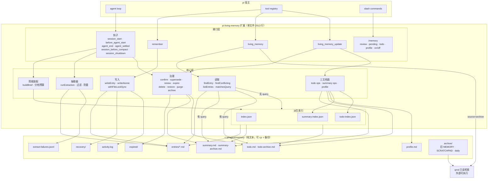
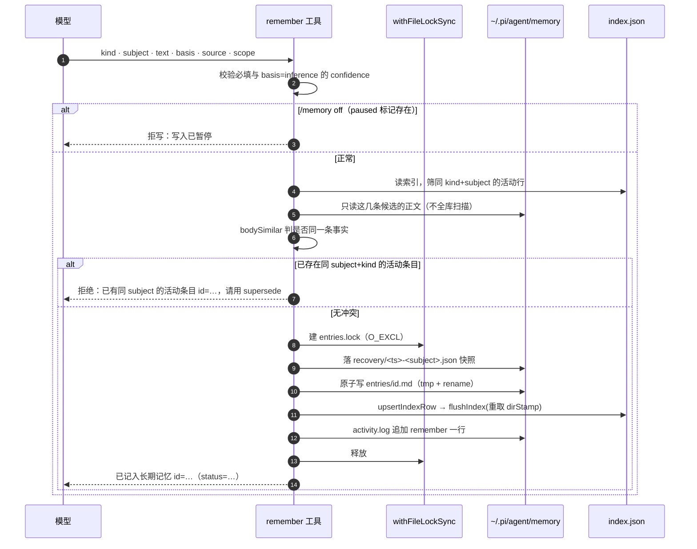
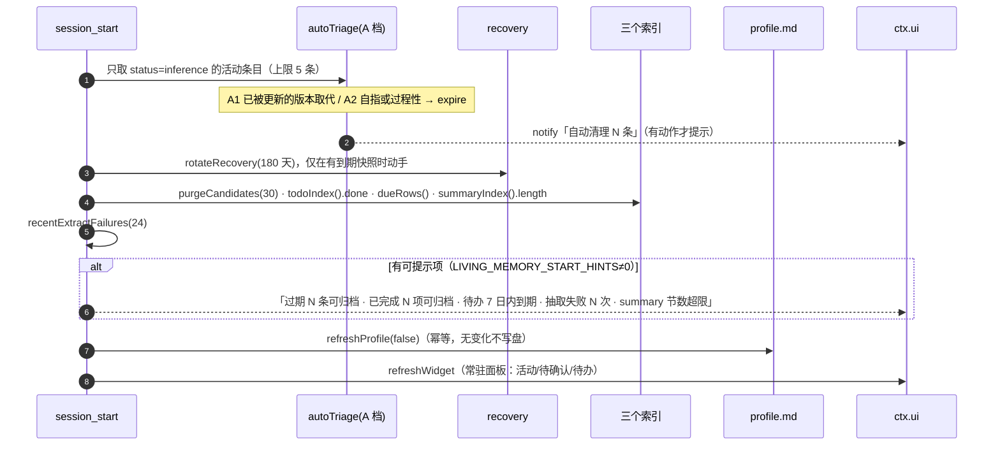
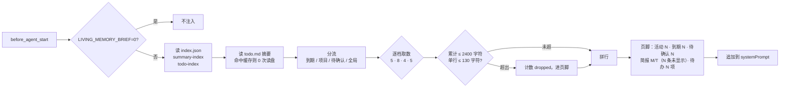
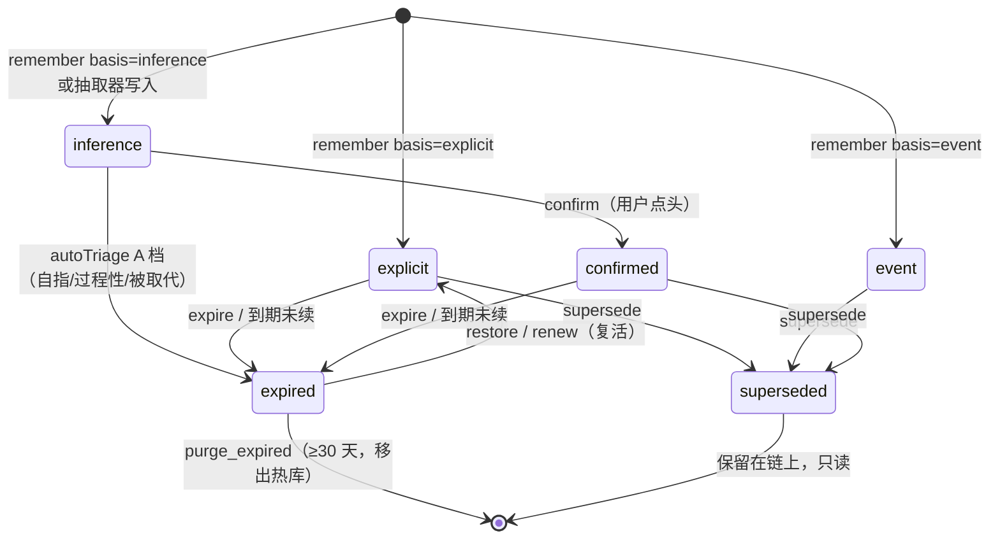
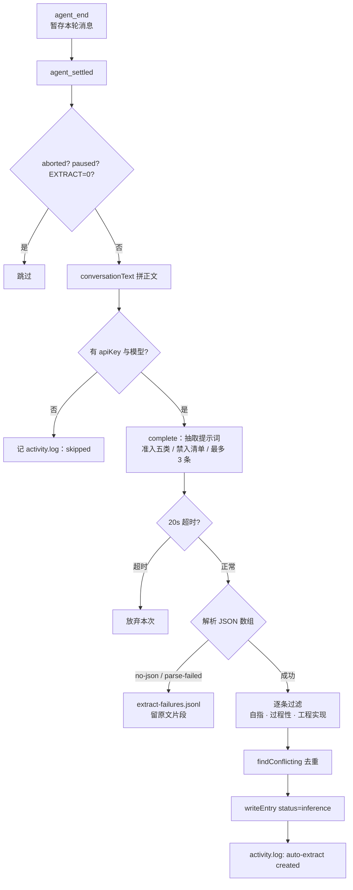

# 架构与数据流

四张图：整体架构、写入时序、启动时序、简报装配，加上条目状态机与抽取流水线。

配图为 `img/` 下的 AI 插画版（`gpt-image-2.6-sunburst` 生成，白底，WebP q88，最长边 1200）：

| # | 图 | 图片 |
|---|---|---|
| 1 | 整体架构 | [01-architecture-ai.webp](img/01-architecture-ai.webp) |
| 2 | 写入时序 `remember` | [02-seq-remember-ai.webp](img/02-seq-remember-ai.webp) |
| 3 | 启动时序 `session_start` | [03-seq-session-ai.webp](img/03-seq-session-ai.webp) |
| 4 | 简报装配流程 | [04-flow-brief-ai.webp](img/04-flow-brief-ai.webp) |
| 5 | 条目状态机 | [05-state-machine-ai.webp](img/05-state-machine-ai.webp) |
| 6 | 抽取流水线 | [06-flow-extraction-ai.webp](img/06-flow-extraction-ai.webp) |
| 7 | 演进路线 | [07-roadmap-ai.webp](img/07-roadmap-ai.webp) |

下文各节的 `mermaid` 代码块是与代码同步的**结构源**（节点与边可直接改）；`mermaid/*.mmd` 是同一份源码的独立文件，需要矢量版时用任意 mermaid 渲染器重新出图。

## 1. 架构图

要点：**简报只读三个索引**（token 成本与库规模脱钩），**正文只在需要时读**（详情、查重候选用、关键词命中）。索引都带戳（`目录 mtime+文件数` 或 `文件 mtime+size`），一旦失配就重建，所以永远可以放心删。

## 2. 写入时序：一次 `remember`

`supersede` 走同一把锁：旧条目 `status=superseded` + 正文追加「被 <新id> 取代」，新条目写入，索引两行一起更新，链不会断。

## 3. 启动时序：`session_start`

设计原则：**启动只提示、不改数据**（唯一例外是 A 档清理和 recovery 轮转，而且都记审计）。搬文件必须是显式命令。

## 4. 每轮简报装配：`before_agent_start`

## 5. 条目状态机

`status` 落在活动集合（`ACTIVE = explicit · event · inference · confirmed`）之外的条目才不进简报；`expired` 目录是**归档而非销毁**。

## 6. 抽取流水线

`session_before_compact` 会再触发一次同样的流水线——对话将被摘要化之前，先把还没落库的候选捞出来，防压缩丢失。

## 7. 为什么不直接用数据库

| 选择 | 原因 |
|---|---|
| 每条事实一个 `.md` 文件 | diff 可读、`git` 友好、`grep` 秒查、单条损坏不影响全库 |
| 三个 JSON 索引 | 只是缓存，能删能重建，不进 git 也不怕丢 |
| 不做向量库 | 语义召回对「事实型记忆」收益有限；关键词 + 元数据足够，且没有模型依赖 |
| qmd 只读外挂 | 冷数据（旧 MEMORY/daily）不值得日常加载，需要时用外部检索器召回 |
