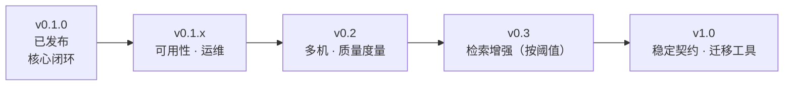

# 演进路线

原则：**先稳住读路径的成本，再加功能**。任何新增能力都必须满足三件事——不涨简报体积、不破坏「派生索引可重建」、不引入自动改写用户事实的路径。

## v0.1.0 — 已发布（2026-11-16）

| 能力 | 状态 |
|---|---|
| 条目生命周期（kind/status/basis/scope/expiry/supersede 链） | ✅ |
| 三个文档面（summary / todo / profile）+ 各自归档 | ✅ |
| 十个检索面（含 lint / routing / expired / archive / extract） | ✅ |
| 派生索引三件套（简报与查重不读正文） | ✅ |
| 跨进程锁 + 原子写 + recovery + activity.log | ✅ |
| 抽取器（含自指/过程性过滤、失败台账） | ✅ |
| 回归测试 21 用例 / 94 断言 | ✅ |

## v0.1.x — 可用性补齐（近期）

1. **`backup` 动作**：`living_memory_update action=backup keep=5` —— 把整个 `memory/` 打成 `tar.gz` 放 `~/.pi/agent/memory-backups/`，按数量轮转，开屏可选提示「上次备份 N 天前」。
2. **`LIVING_MEMORY_STORE`**：数据目录可配（现在写死 `$HOME/.pi/agent/memory`）。这是把包给别人用的前置条件；同时让「同一台机器、多个隔离记忆库」成为可能。
3. **npm 发布**（`private: true` 去掉 → `npm publish` → `pi install npm:pi-living-memory@0.1.x`），配 GitHub Actions 跑 `bun tests/run.ts`。
4. **测试补齐**：并发用例目前靠子进程手搓，纳入套件；补 `renew` / `rotate_recovery` / `todo_edit` 的边界断言。
5. **`docs/` 纳入包**：本目录随包发布（`files` 加 `docs`），README 顶部挂索引。

## v0.2 — 多机与质量度量

1. **导入/合并**：`living_memory_update action=import file=...` —— 两个机器各自的条目合并时按 `id` 去重、`superseded` 链按 `obtained_at` 取最新，冲突写 `lint` 待人工裁决。
2. **抽取质量看板**：`source=extract` 增加「近 30 天抽取 N 条 / 被 confirm M / 被 expire K」的命中率，用于判断抽取提示词是否退化（当前只有失败台账，没有效率指标）。
3. **brief 可观测**：简报页脚追加「本轮注入 X 字符」，配额吃紧时能立刻看出是哪一档在挤。
4. **`profile.md` 正文的半自动草稿**：只生成「候选结论 + 证据 id」，落 `profile-draft.md` 供人采用，**绝不直接改写 profile.md**。

## v0.3 — 检索增强（触发条件驱动）

只有在**条目数 > 1000** 时才做，现在做属于过度设计：

1. **`entries` 查询先走索引**：`query` 命中 `subject/title` 的在索引里筛完再读正文；纯正文关键词仍全扫（这条路径本来就是低频）。
2. **条目按年分目录**（`entries/2026/`），`readdir` 从 O(全库) 降到 O(一年)。同时 `expired/` 超过 2 年的物理删除（现在只做 30 天以上移到归档区）。
3. **可选语义召回**：本地 embedding（`sqlite-vec` 或 qmd 现有的向量库）作为**附加检索面**，默认关闭，只解决「我记得说过类似的话但想不起词」这一种查询。**不做常驻向量库**，索引随用随建。

## v1.0 — 稳定契约

1. **工具参数冻结**：`remember` / `living_memory` / `living_memory_update` 的参数与返回文案版本化，破坏性变更必须升大版本并提供 `action=migrate`。
2. **数据格式契约**：`entries/*.md` 的 frontmatter 字段表定为公开格式，第三方工具可读写；派生索引格式不保证稳定。
3. **迁移工具**：从旧 `MEMORY.md` / `SCRATCHPAD.md` / `daily/` 自动分流的再实现（现在是手工迁移，只做过一次），供他人从零接管。
4. **回滚演练**：`pi install ... @v0.9.9` → 数据不动 → 回 v1.0 的完整验证流程写进测试。

## 明确不做

| 不做 | 原因 |
|---|---|
| 云端同步 / 多端实时一致 | 引入网络与冲突解决，收益远小于「纯文本 + git」的简单性 |
| 自动 `confirm` 推断 | 破坏「待确认只作弱参考」的契约，是记忆污染的源头 |
| 常驻向量库 | 模型依赖 + 索引漂移，关键词检索对事实型记忆已足够 |
| 让 AI 自动改写 `profile.md` 结论 | 画像的价值在于人的判断，机器只能提供候选 |
| 把 TODO/SUMMARY 塞进条目 | 三个面各有害处与好处，合并会重演「只增不减」的老问题 |

## 维护节奏建议

- 每完成一批改动：`bun tests/run.ts` → `git commit` → `git tag v0.x.y`；
- 每 30 天：`source=lint` 看有没有重复/矛盾，`source=expired` 看归档区是否需要 purge；
- 每季度：看一次 `source=extract` 的失败率与 `profile.md` 的统计块，决定是否调整抽取模型或复核期。
